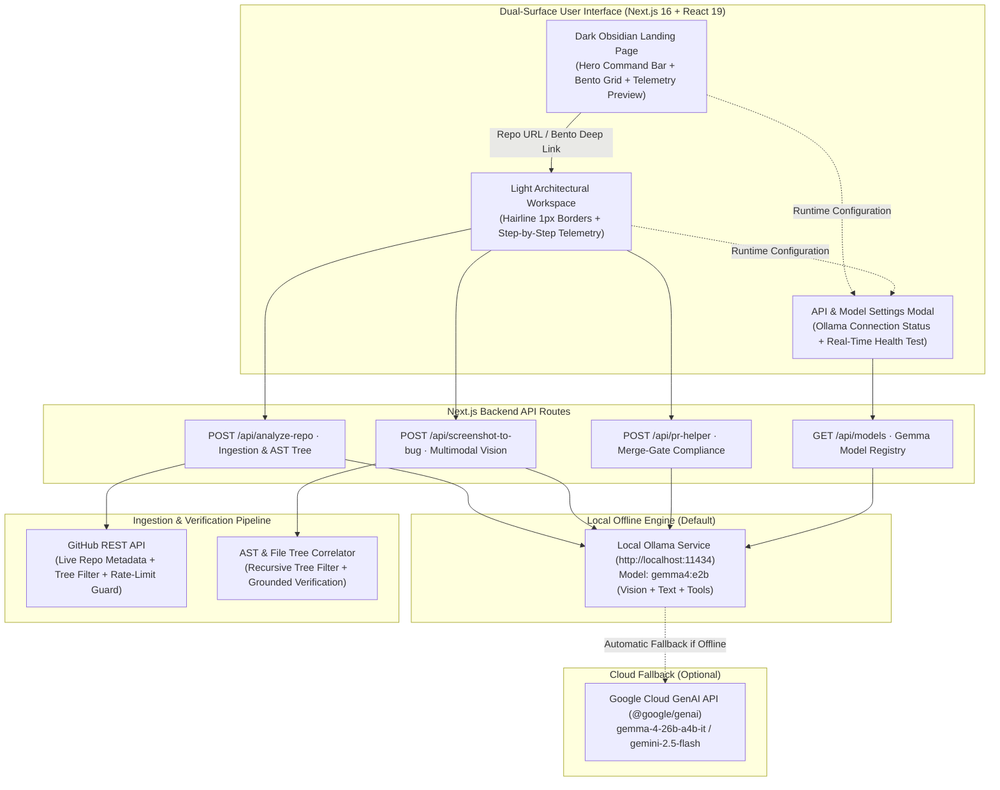

# GitCompass 404 — Autonomous Open-Source Contributor & Maintainer Intelligence

<div align="center">

> **Navigate Any Codebase. Ship Verified Issues & PRs in Seconds.**  
> Powered by **Local Google Gemma 4 (`gemma4:e2b` via Ollama)** running 100% offline on your PC, with Google Cloud Gemini API fallback.

[](LICENSE)
[](https://nextjs.org/)
[](https://react.dev/)
[](https://www.typescriptlang.org/)
[](https://ollama.com/)
[](https://deepmind.google/technologies/gemma/)
[](https://tailwindcss.com/)
[](CONTRIBUTING.md)

</div>

---

## 👥 The Developers — Team 404 Not Found

GitCompass 404 was engineered with pride and contributed to the global open-source community by **Team 404 Not Found**:

| Role | Developer | Focus & Responsibilities |
|---|---|---|
| 👑 **Team Leader** | **Parshwa** | Full-Stack Architecture, Local Gemma 4 Engine, AST Correlation & Project Leadership |
| 💻 **Core Engineer** | **Sakshi Sharma** | Frontend Architecture, Obsidian/Alabaster Dual-Surface UX, Responsive Micro-Interactions |
| 💻 **Core Engineer** | **Adarsh Milan** | Backend API Pipeline, GitHub REST Ingestion, Rate-Limiting & In-Memory Cache |
| 💻 **Core Engineer** | **Abhishek Kumar** | Multimodal Vision Triage Pipeline, Optical Character Callstack OCR, Executive Dossier & PDF Engine |

---

## 🎯 The Mission & Problem Solved

Every year, millions of developers attempt to make their first open-source contribution, but hit a wall:
- **Monolithic Overwhelm**: Codebases with 50,000+ files provide zero cognitive entry point or subsystem map.
- **Vague Bug Reports**: Maintainers spend 60% of triage time chasing down reproduction steps and missing callstack details.
- **PR Merge-Gate Regressions**: Over 70% of first-time pull requests are rejected or stall because contributors miss repository-specific `CONTRIBUTING.md` guidelines or conventional commit formats.

**GitCompass 404** solves this on both fronts using **Local Google Gemma 4 (`gemma4:e2b`)**:
1. **For Contributors**: Decodes architectural layers, points out the top 3 beginner-friendly files to edit first, finds hidden "beginner gems" among open issues, and guides clean PR drafting.
2. **For Maintainers**: Ingests screenshots of error traces via multimodal vision, extracts callstacks, isolates culprit AST nodes in the file tree, verifies against `CONTRIBUTING.md`, and exports executive diagnostic dossiers in PDF.

---

## ⚡ The Five Intelligent Workflows

```
┌─────────────────────────────────────────────────────────────────────────────┐
│                              GITCOMPASS 404                                 │
├─────────────┬─────────────┬─────────────┬───────────────────┬───────────────┤
│   TAB 01    │   TAB 02    │   TAB 03    │      TAB 04       │    TAB 05     │
│    Repo     │ Good-First  │ Screenshot  │  PR Description   │   Executive   │
│  Explainer  │ Issue Gems  │ Bug Triage  │  & Rules Helper   │ Dossier (PDF) │
└─────────────┴─────────────┴─────────────┴───────────────────┴───────────────┘
```

| # | Workflow | Inputs | Intelligence Engine | Key Outputs & Autonomous Actions |
|---|---|---|---|---|
| **01** | **Repo Explainer & Architecture Map** | GitHub Repo URL | **Local Gemma 4 (`gemma4:e2b`)** | • Multi-layer subsystem map (Gateway, Core, Primitives)<br/>• Top 3 beginner files with line counts & direct GitHub links<br/>• Structural directory purpose cards<br/>• 60-second clone and setup terminal commands |
| **02** | **Good-First-Issue Finder & Gem Scorer** | GitHub Repo URL | **Local Gemma 4 (`gemma4:e2b`)** | • Ranks open issues by cognitive load & clarity score (0–100%)<br/>• Flags **Unlabeled Beginner Gems** (easy bugs without labels)<br/>• Suspected file tags & actionable 3-step solution plans<br/>• 1-Click direct links to open issues on GitHub |
| **03** | **Screenshot → Bug Report [Multimodal Vision]** | Error Screenshot (`Ctrl+V` Paste or Upload) + Notes | **Local Gemma 4 Multimodal Vision (Ollama)** | • Optical Character Callstack OCR from visual error traces<br/>• Correlates errors with real repository file tree AST nodes<br/>• Extracts reproduction steps & root cause evidence<br/>• **1-Click `Create Issue on GitHub ↗`** prefilled URL |
| **04** | **PR Description & Merge-Gate Helper** | Git Diff / Patch | **Local Gemma 4 (`gemma4:e2b`)** | • Ingests & validates repository's real `CONTRIBUTING.md`<br/>• 4-point merge gate audit (Conventional Commits, linked issue, test plan, breaking changes)<br/>• Compliant PR markdown generator<br/>• Direct **`Compare & Open PR ↗`** button |
| **05** | **Executive Dossier & Instant PDF Export** | Full Workspace Session State | **Client-Side Vector Render Engine** | • Synthesizes repository health, visual architecture, issue triage, and PR draft into an executive report<br/>• One-click export to clean, printable PDF dossier<br/>• Complete repository readiness diagnostic summary |

---

## 💻 100% Local & Offline Gemma 4 Engine (Ollama)

GitCompass 404 runs natively with **Ollama** on your local machine:
- **Zero API Keys Required**: No external credentials or subscription tokens necessary.
- **100% Offline & Private**: Code files, diffs, and error screenshots stay on your machine.
- **Hardware Optimized**: Runs on local consumer laptops via `gemma4:e2b` (Q4_K_M quantization with 131,072 context window).
- **Multimodal Vision Enabled**: Handles raw base64 image tensors directly in local Ollama memory.
- **Seamless Cloud Fallback**: Automatically falls back to Google Cloud Gemini API (`@google/genai`) only if Ollama is paused.

---

## 🏗️ System Architecture



---

## 🎨 Dual-Surface Design System

GitCompass 404 incorporates a distinctive **Dual-Surface** design philosophy:

| Surface | Color Palette | Typography & Feel | Purpose |
|---|---|---|---|
| **Landing Page** | Dark Obsidian (`#070708` / `#0F0F12`), hairline graphite (`#27272A`), neon emerald accents | Inter, JetBrains Mono, sleek glow effects | Command bar, high-impact storytelling, feature discovery, deep-linking |
| **Workspace** | Crisp White (`#FFFFFF`), Alabaster (`#FAFAFA`), Carbon Black (`#09090B`) | Clean architectural typography, 1px borders (`#E4E4E7`) | High-density productivity, focused triage, reading code, exporting reports |

---

## 🚀 Quickstart & Setup Guide

### 1. Prerequisites
- **Node.js**: `v20.9.0` or newer
- **Ollama**: Installed locally with the `gemma4:e2b` model:
  ```bash
  ollama pull gemma4:e2b
  ollama serve
  ```

### 2. Installation
```bash
# Clone the repository
git clone https://github.com/Adarshmilan/hacktober2026.git
cd hacktober2026

# Install dependencies
npm install
```

### 3. Start Development Server
```bash
npm run dev
```
Open **[http://localhost:3000](http://localhost:3000)** in your browser.

> [!TIP]
> **Zero Configuration**: Since Ollama is running on your laptop at `http://localhost:11434`, all 5 tabs work immediately without setting any environment variables!

---

## 🧪 Quality Assurance & Build Verification

The codebase adheres to strict engineering standards:
```bash
# TypeScript strict type checking (0 errors)
npm run typecheck

# Code formatting check
npm run format:check

# Production bundle compilation
npm run build
```

---

## 🛡️ Security & Responsible AI

- **Grounded Verification**: All file references and line citations generated by Gemma 4 are correlated with the real repository tree to prevent hallucinations.
- **Client-Side Credential Storage**: If a user optionally supplies a GitHub PAT or cloud Gemini key, it is stored only in the browser's `localStorage` and sent over local loopback.
- **SSRF & Input Guardrails**: Target repository URLs are validated against `https://api.github.com` with URL segment escaping and SSRF protections.

---

## 🤝 Contributing to Open Source

GitCompass 404 was built for the open-source community, by the open-source community. We welcome your contributions:

1. Fork the Project
2. Create your Feature Branch (`git checkout -b feature/AmazingFeature`)
3. Commit your Changes (`git commit -m 'feat(scope): add amazing feature'`)
4. Push to the Branch (`git push origin feature/AmazingFeature`)
5. Open a Pull Request using **GitCompass 404's PR Helper**!

See [`CONTRIBUTING.md`](CONTRIBUTING.md) for full details.

---

## 📄 License & Attribution

Distributed under the **MIT License**. See [`LICENSE`](LICENSE) for complete terms.

Designed and developed by **Team 404 Not Found**:
- **Parshwa** (Team Leader)
- **Sakshi Sharma**
- **Adarsh Milan**
- **Abhishek Kumar**

