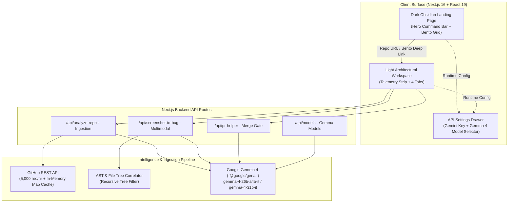

# GitCompass 404 — Autonomous Open-Source Contributor & Maintainer Intelligence

> **Navigate Any Codebase. Ship Verified Issues & PRs in Seconds.**  
> Powered by **Google Gemma 4 (Text + Multimodal Vision)** via the Gemini API (`@google/genai`).

[](LICENSE)
[](https://nextjs.org/)
[](https://www.typescriptlang.org/)
[](https://deepmind.google/technologies/gemma/)
[](https://tailwindcss.com/)

---

## 🎯 Overview

Contributors get overwhelmed by massive 50,000-file codebases with zero idea where execution begins. Maintainers drown in incomplete bug reports and malformed pull requests that fail merge rules.

**GitCompass 404** bridges both sides of open-source engineering using **Google Gemma 4 (Text + Multimodal Vision)**. It provides a unified, dual-surface platform:
1. **Dark Obsidian Animated Landing Page (`#070708` / `#0F0F12`)**: High-impact command bar, live telemetry previews, dual persona comparison, and interactive Bento grid.
2. **Light Architectural Workspace (`#FFFFFF` / `#FAFAFA`)**: Hairline 1px borders, carbon black controls, step-by-step monochrome telemetry stream, and 4 specialized engineering workflows.

---

## ⚡ The Four Core Workflows

| Workflow | Inputs | Google Gemma 4 Intelligence | Output & Actions |
|---|---|---|---|
| **01. Repo Explainer & Architecture Map** | GitHub Repo URL | Analyzes `README.md` + recursive file tree to decode subsystem architecture. | Structural directory map, top 3 beginner-friendly entry files with direct clickable links, and 60s quickstart copy commands. |
| **02. Good-First-Issue Finder & Gem Scorer** | GitHub Repo URL | Ranks open issues by cognitive load, clarity (0-100%), and detects **Unlabeled Beginner Gems**. | Plain-language overviews, suspected file pills, 3-step action plan, and direct `Open Issue on GitHub ↗` links. |
| **03. Screenshot → Bug Report [Multimodal Flagship]** | Error Screenshot (PNG/JPG/WebP or `Ctrl+V` Paste) + Context | Reads callstacks & visual errors via **Gemma 4 Multimodal Vision** and correlates them with the repo's file tree. | Correlated File AST Map (confidence % + line range), structured GitHub Issue Markdown, and 1-click **`Create Issue on GitHub ↗`** prefilled URL. |
| **04. PR Description & Merge-Gate Helper** | Git Diff / Patch | Audits diff against repository's `CONTRIBUTING.md` and PR templates. | Merge-gate compliance checklist (Conventional Commits, linked issue, test plan), PR markdown, and **`Compare & Open PR ↗`** button. |

---

## 🏗️ System Architecture



---

## 🚀 Quickstart & Setup

### 1. Prerequisites
- **Node.js**: `v20.9.0` or newer
- **npm** or **pnpm**

### 2. Installation
```bash
# Clone the repository
git clone https://github.com/your-username/git-compass-404.git
cd git-compass-404

# Install dependencies
npm install
```

### 3. Configure Environment Variables
Copy `.env.example` to `.env.local`:
```bash
cp .env.example .env.local
```
Fill in your credentials:
```env
# Get your free key at https://aistudio.google.com/apikey
GEMINI_API_KEY=your_gemini_api_key_here

# Recommended Gemma 4 Model
GEMMA_MODEL=gemma-4-26b-a4b-it

# Optional: GitHub Personal Access Token for 5,000 req/hr limit
GITHUB_TOKEN=your_github_token_here
```
*(Note: You can also leave `.env.local` blank and enter credentials directly inside the in-app **API Settings** modal in your browser).*

### 4. Run Development Server
```bash
npm run dev
```
Open **[http://localhost:3000](http://localhost:3000)** in your browser.

---

## 🧪 Verification & Build Checks

To verify type safety and build health:
```bash
# TypeScript strict typecheck
npm run typecheck

# Production build bundle
npm run build
```

---

## 🛡️ Security & Privacy Guardrails

- **Zero Arbitrary Execution**: Server calls strictly query `https://api.github.com` with segment encoding and SSRF protection.
- **Client Credential Isolation**: Runtime API keys supplied in the settings modal are persisted only in the user's browser `localStorage` and sent over HTTPS/local loopback to the API routes.
- **Grounded Verification**: All file references returned by Gemma 4 are verified against the real repository tree paths to prevent hallucinations.

---

## 📄 License

Distributed under the **MIT License**. See [`LICENSE`](LICENSE) for details.
