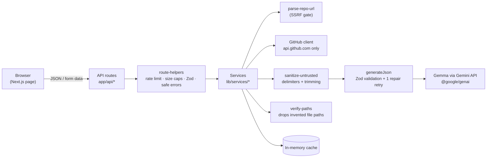

# OpenSource Contributor Helper

**Your first open-source contribution, made easier.** Paste a public GitHub repository and get a
beginner-friendly tour of it, a ranked list of good first issues, ready-to-file bug reports from
screenshots, and clear pull request descriptions. Powered by **Gemma** through the **Gemini API**.

Built for Hacktoberfest. MIT licensed. Bring your own API key.

## Features

| Feature                     | What you give it                                  | What you get                                                                                                                                                              |
| --------------------------- | ------------------------------------------------- | ------------------------------------------------------------------------------------------------------------------------------------------------------------------------- |
| **Repo explainer**          | A repo URL                                        | Summary, tech stack, how to run it locally, key folders and where to start, with the source file for every claim                                                          |
| **Good-first-issue finder** | A repo URL                                        | Open, unassigned issues ranked easy → hard, each with why it suits a beginner, likely files and a first step                                                              |
| **Screenshot → bug report** | A screenshot (+ optional notes and repo)          | A structured issue: title, steps, expected vs actual, environment, labels and questions to answer before filing, plus a link that opens GitHub's new-issue form prefilled |
| **PR description helper**   | A diff or list of changed files (+ optional repo) | A PR title, description, change list, testing notes and checklist, following the repo's PR template when one exists                                                       |

Every feature can answer in **English, Hindi or Gujarati**. Code, commands and file paths stay
in English. You can also switch between any Gemma model your API key can use.

## Architecture



Route handlers stay thin. All logic lives in `src/lib/`:

```
src/
├─ app/              page, layout and API routes (explain, issues, bug-report, pr, models)
├─ components/       layout, forms, results and ui building blocks
├─ lib/
│  ├─ config/        env validation (server only) and shared size limits
│  ├─ github/        repo URL parsing and GitHub API fetchers
│  ├─ gemma/         SDK client, model list, generateJson and prompts
│  ├─ services/      one orchestrator per feature
│  ├─ security/      rate limiting, image validation, untrusted-text sanitizing
│  ├─ cache/ http/ utils/ client/
├─ schemas/          Zod schemas for every request and model response
└─ types/            shared TypeScript types
```

## Tech stack

Next.js 16 (App Router) · TypeScript (strict) · Tailwind CSS 4 · `@google/genai` · Zod 4 · Vitest ·
ESLint + Prettier. No database, no accounts.

## Getting started

Requirements: **Node.js 20.9+** and npm.

```bash
git clone <your-fork-url> repo-helper
cd repo-helper
npm install
cp .env.example .env.local   # then fill in the values below
npm run dev                  # open http://localhost:3000
```

### Environment variables

| Variable             | Required | Default | What it is                                                                    |
| -------------------- | -------- | ------- | ----------------------------------------------------------------------------- |
| `GEMINI_API_KEY`     | yes      | —       | Your Gemini API key. Used only on the server.                                 |
| `GEMMA_MODEL`        | yes      | —       | The default Gemma model, e.g. `gemma-4-26b-a4b-it`. Must start with `gemma-`. |
| `GITHUB_TOKEN`       | no       | —       | Raises GitHub's limit from 60 to 5,000 requests per hour.                     |
| `MAX_IMAGE_MB`       | no       | `4`     | Maximum screenshot size in MB (up to 20).                                     |
| `RATE_LIMIT_PER_MIN` | no       | `20`    | Maximum API requests per minute per IP address.                               |

### Getting the keys

- **Gemini API key:** sign in at [Google AI Studio](https://aistudio.google.com/apikey) and create a key.
- **Gemma model name:** list every model your key can use and pick a `gemma-…` one that accepts images:
  ```bash
  curl "https://generativelanguage.googleapis.com/v1beta/models?key=$GEMINI_API_KEY" | grep '"name": "models/gemma'
  ```
  At the time of writing, `gemma-4-31b-it` and `gemma-4-26b-a4b-it` are available. The app's
  model dropdown shows the live list, so users can switch without editing `.env.local`.
- **GitHub token (optional):** create a [fine-grained token](https://github.com/settings/personal-access-tokens)
  with **no extra permissions**. Public, read-only access is all the app needs.

## Usage

Open the app, paste a repository such as `expressjs/express` or `https://github.com/vercel/next.js`,
pick a tab and submit. You can also call the API directly:

```bash
# Explain a repo
curl -s -X POST localhost:3000/api/explain -H 'content-type: application/json' \
  -d '{"repoUrl":"expressjs/express","language":"en"}'

# Rank beginner issues (answer in Hindi)
curl -s -X POST localhost:3000/api/issues -H 'content-type: application/json' \
  -d '{"repoUrl":"expressjs/express","language":"hi"}'

# Screenshot -> bug report (multipart form)
curl -s -X POST localhost:3000/api/bug-report \
  -F image=@screenshot.png -F notes="Clicked Save" -F repoUrl=owner/repo

# PR description from a diff
git diff main | jq -Rs '{diff: .}' | curl -s -X POST localhost:3000/api/pr \
  -H 'content-type: application/json' -d @-

# Gemma models available to your key
curl -s localhost:3000/api/models
```

Every response is either `{ "ok": true, "data": … }` or
`{ "ok": false, "error": { "code": "…", "message": "…" } }`. Error codes: `INVALID_INPUT`,
`REPO_NOT_FOUND`, `GITHUB_RATE_LIMIT`, `IMAGE_INVALID`, `RATE_LIMITED`, `MODEL_ERROR`, `INTERNAL`.

## Scripts

| Command                       | What it does                |
| ----------------------------- | --------------------------- |
| `npm run dev`                 | Start the dev server        |
| `npm run build` / `npm start` | Production build and server |
| `npm test`                    | Run the Vitest suite        |
| `npm run lint`                | ESLint                      |
| `npm run typecheck`           | TypeScript, no emit         |
| `npm run format`              | Prettier (write)            |

## Security

- **Keys stay on the server.** They are read only in `lib/config/env.ts`, which cannot be imported
  into browser code (`server-only`). They never appear in responses or logs.
- **No SSRF.** Repo input is parsed into a strictly validated `owner` and `repo`. The app only ever
  calls `api.github.com` and the Gemini API, and never fetches a user-supplied URL.
- **Prompt-injection defenses.** README, issue, diff and note text is wrapped in delimiters that
  the content cannot fake, and every prompt tells the model to treat it as data only.
- **Grounded answers.** File paths the model cites are checked against the real repo; invented
  paths are removed or marked "unknown". Issue titles and links always come from GitHub.
- **Uploads.** PNG, JPEG and WebP only, checked by file signature, size-limited, processed in
  memory, sent inline to the Gemini API and never written to disk or logged.
- **Limits.** Per-IP rate limiting, request-size caps and generic error messages with codes.
- **Safe rendering.** Model output is shown as plain text, never as raw HTML.

See [SECURITY.md](SECURITY.md) to report a vulnerability.

## Limitations

- Rate limits and caches live in server memory. On serverless hosts each instance keeps its own,
  so limits are best-effort and caches reset on cold starts.
- Without a proxy in front (for example when running locally), all clients share one rate-limit bucket.
- Very large repos are summarized from the top 400 relevant paths and a trimmed README.
- Answers come from a language model and can be wrong. Hindi and Gujarati quality depends on the model.
- Only public repositories are supported.

## Roadmap

- Shared rate limiting and caching (for example Redis) for multi-instance deployments
- Streaming responses so long answers appear progressively
- "Explain this file" deep dives from the explainer
- More output languages
- Private repository support via GitHub OAuth

## Contributing

Contributions are welcome. Start with [CONTRIBUTING.md](CONTRIBUTING.md) and the
[Code of Conduct](CODE_OF_CONDUCT.md).

## License

[MIT](LICENSE)
